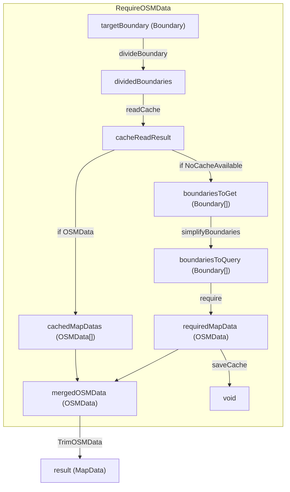

# OSM Cache

OSM から取得した地図情報をキャッシュする仕組み

## 概要

このキャッシュシステムは以下のような仕組みで動作します

1. 取得対象範囲の Boundary を囲うように適当なグリッドで丸めグリッド上の要素ごとに分解する
2. それらのグリッドのうち有効なキャッシュが存在しないようなグリッド (新規グリッド) を集める
3. 新規グリッドを長方形領域である程度簡約化する
4. 簡約化した領域情報を基に OSM 側からデータを取得する (新規地図情報)
5. 新規地図情報をキャッシュに保存する
6. 新規地図情報とキャッシュに存在していたグリッドをマージする
7. 取得した OSMData の way について取得対象範囲外にあるものをトリムする (孤立ノードの削除を含む)
8. トリムした OSMData を返す

## データフロー

```ts
type Boundary = {minLat: number, maxLat: number, minLng: number, MaxLng: number};
```


