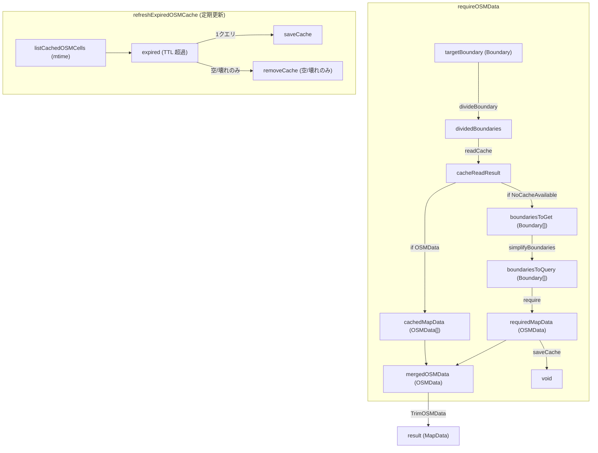

# OSM Cache

OSM から取得した地図情報をキャッシュする仕組み
取得経路は検索経路 (`requireOSMData`) と、失効したキャッシュを取り直す定期更新 (`refreshExpiredOSMCache`) の 2 経路がある

## 検索経路

1. 取得対象範囲の Boundary を囲うように適当なグリッドで丸めグリッド上の要素ごとに分解する
2. それらのグリッドのうち有効なキャッシュが存在しないようなグリッド (新規グリッド) を集める
   - キャッシュファイルがあっても中身が空 (要素が 0 件) なら「新規」とみなして取り直す
   - 壊れた JSON (パース不能・形が違う) も新規とみなす
3. 新規グリッドを長方形領域である程度簡約化する
4. 簡約化した領域情報を基に OSM 側からデータを取得する (新規地図情報)
5. 新規地図情報をキャッシュに保存する
6. 新規地図情報とキャッシュに存在していたグリッドをマージする
7. 取得した OSMData の way について取得対象範囲外にあるものをトリムする (孤立ノードの削除を含む)
8. トリムした OSMData を返す

セルは `OSM_CACHE_DIR/{minLat}-{minLng}-{maxLat}-{maxLng}.json` というファイルに
1 セル 1 ファイルで保存する。

## 取得時刻と TTL

セルがいつ取得されたかは**ファイル mtime** で保持する。

`OSM_CACHE_TTL_DAYS` の解釈:

| 値                                           | 結果                 |
| -------------------------------------------- | -------------------- |
| 未設定・空文字                               | 30 日                |
| `0`                                          | 失効させない         |
| `30日` / `-0` / `1e301` などの解釈できない値 | 警告して 30 日に倒す |

`0` と不正値を区別するのは、不正値を「失効しない」側に倒すと
`OSM_CACHE_TTL_DAYS=30日` という打ち間違いで更新がログも残らず永久に止まるため。
`1e301` は日数の値としては有限でもミリ秒に換算すると `Infinity` になるので、
積のほうも検証している。

## 空データをキャッシュにしない

`saveCache` は空を保存せず、`readCache` は空をヒットにしない。

空で上書きすると mtime が現在時刻になり、そのセルは失効していないと判定されて
TTL の間そのまま地図が空になる。保存しないことで次回の検索が再取得する。

## 一時ファイル

`saveCache` は `{base}-tmp.{pid}.{seq}.json` に書いてから `rename` することで、 atomic に更新する。
プロセスが `rename` 前に死ぬ（SIGKILL / OOM）と一時ファイルが残る。
更新ジョブの冒頭で **1 時間以上古いものだけ**削除する（削除件数は journal に出る）。
`my-important-tmp.backup.json` のような無関係なファイルは消さない。

## 既知の制約

- **同時失効（thundering herd）**: セルは探索された時点で入るので TTL も一斉に満了する。
  猶予 30 日が経過すると全セルが同じ実行で失効し、1 クエリに大量の bbox 句が詰まる。
  `fetchOverpassData` の `[timeout:30]` は固定なので、広い範囲は 429/504 を返し、
  その実行は全セル `failed` で終わる
  これは 429/504 だけでなく **OOM** にも及ぶ。1 クエリの応答を 1 個の
  `App.OSMData` として実体化するため、全セルが同時に失効すると都市全体の
  highway graph が一度にメモリに載る。セル数の上限を入れたほうが安全な理由もここにある
- **`fetch` にタイムアウトが無い**: Overpass が接続を開いたまま応答しない場合、
  呼び出し元（`curl --max-time 600`）までハングする
- **eviction（使われなくなったセルの削除）は未実装**。TTL は上書きのみ

## データフロー

