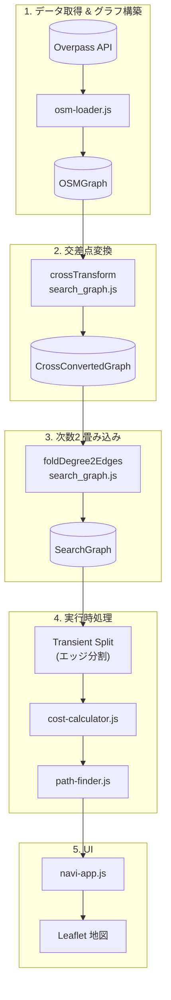

# グラフモデル

## グラフの種類

### OSMGraph

OSM から取得した生のグラフ。Way がそのままエッジになり、ノードは座標を持つ。
交差点ノードと形状ノードの区別はなく、次数 2 の中間点も多数含む。

### CrossConvertedGraph

OSMGraph 上の全ノードのうち次数 ≥ 3 のノードを、仮想的な強連結グラフ（SCC）に置換したグラフ。
交差点の共有ノードを SCC に変換することで、交差点通過時の回頭曲率を (進入エッジ, 退出エッジ) の
ペアごとに経路探索時に遅延評価できる。ラウンドアバウト上のノード（次数 ≥ 3）も例外なく変換対象となる。

出力: `crossTransform(osmGraph) → CrossConvertedGraph`

### SearchGraph

次数 2 のノード連鎖を 1 本の `FoldedEdge` に圧縮したグラフ。
連鎖内の属性変化（`highway` / `width` / `sidewalk`）で `segments[]` に分割し、中間ノードの座標は `group_nodes` に保持する。
経路探索の実行用グラフ。

出力: `foldDegree2Edges(crossConvertedGraph) → SearchGraph`

## データフロー

| 段階 | 入力 | 処理 | 出力 |
|------|------|------|------|
| 1 | Overpass API (JSON) | `osm-loader.js` | `OSMGraph` |
| 2 | `OSMGraph` | `crossTransform` | `CrossConvertedGraph` |
| 3 | `CrossConvertedGraph` | `foldDegree2Edges` | `SearchGraph` |
| 4 | `SearchGraph` | Transient Split | セッション用グラフ |
| 5 | セッション用グラフ | `cost-calculator.js` | score 付きエッジ |
| 6 | score 付きエッジ | `path-finder.js` | 経路 (NodeId 列) |
| 7 | NodeId 列 | `navi-app.js` | Leaflet polyline |

## OSM データは経路探索に使うだけ

地図上に信号機・POI・barrier などを描画しない。
OSM データは経路探索専用。

### 帰結: `SplitOSMData` は孤立ノードを含めない

way から参照されない孤立ノードをチャンクに含めない。

`trimOSMData` は境界内の孤立ノードをすべて残すため、両者でキャッシュの内容が一致しない。
これは**意図した差分**であり不具合ではない。

- 孤立ノードはどの way からも参照されないので、グラフ描画にも経路探索にも寄与しない
- way に参照されるノードは `outputNodes` 経由で必ずチャンクに入るため、グラフ構築と探索の完全性は保たれる
- その結果、キャッシュが小さくなり `SplitOSMData` の実行も速い

### 注意事項

この差分を見つけて「`trimOSMData` と一致していないのはバグだ」と**修正しないこと。**

`app/tests/osm-cache/split-osm-data.test.ts` の
「孤立ノード（way から参照されない node）は要素に入らない」テストが
この意図的な仕様を固定化している。
対照として `trimOSMData` は孤立ノードも残すと明記。

地図上にノードを描画する機能が将来必要になったら、この決定を再検討する。
