# グラフ変換パイプラインの設計変更 (v2)

## 変更の背景

これまで設計ドキュメント (`.agents/design/03-graph-model.md`) では以下の順序を前提としていた：

1. `foldDegree2Edges` → 次数2連鎖の畳み込み
2. `extractIntersections` → 交差点抽出

しかし、実際の処理に照らして以下の順序が正しいことが判明した：

1. `extractIntersections` → 交差点抽出（**先**）
2. `foldDegree2Edges` → 次数2連鎖の畳み込み（**後**）

## 理由

交差点判定の基本ルール（OSM 公式 Wiki より）:
> "Where ways intersect at the same altitude, the two ways **must share a node**."

このルールに基づくと、**交差点判定はノードの次数（＝共有する Edge 数）のみで決定できる**。座標列や曲率は不要であり、fold（畳み込み）より先に行うのが自然である。

fold の前に交差点を確定しておけば、fold 時の「アンカーとするノード」が明確になる（次数≥3 の交差点ノード、既存 SCC、次数1 の端点）。

## 現状 (v1) の問題点

### コード (`app/src/lib/`)

| ファイル | 現在の責務 | 問題 |
|----------|-----------|------|
| `cross_transform.js` | `TransformGraph(osmGraph) → SearchGraph` (stub) | 1関数で交差点抽出＋畳み込みを混在。中身が未実装のまま |
| `cost_calculator.js` | `CalculateCost(FoldedEdge) → ComputedEdge` | 引数が `FoldedEdge` だが、その型が未整備 |
| `map_loader/osm.js` | `loadOSMMap → OSMGraph` (stub) | デバッグ用データしか出力しない |
| `map_loader/debug.ts` | `loadDebugMap → OSMGraph` | GeoJSON からの変換で、各セグメントを独立した `OSMEdge` として出力 |
| `path_finder.js` | `PathFind(graph, begin, end) → Coordinate[]` (stub) | 引数 `graph` の型があいまい |

### 型定義 (`app.d.ts`) の問題

- `CrossedGraph` 型が存在しない（交差点抽出後、畳み込み前の中間状態）
- `FoldedEdge` に `segments`, `curve_score`, `group_nodes` が欠けている（現在は `points` のみ）
- `SegmentAttr` 型が存在しない

## 変更後のアーキテクチャ

### パイプライン

```
OSMGraph
  │
  ▼
extractIntersections(osmGraph) ─→ CrossedGraph
  │  ・全ノードの次数を計算
  │  ・共有ノードを crossNode としてマーク
  │  ・既存 SCC を検出・維持
  │
  ▼
foldDegree2Edges(crossedGraph) ─→ SearchGraph
  │  ・次数2連鎖をトレース
  │  ・連鎖内の属性変化点で segments[] 分割
  │  ・座標列から curve_score 算出
  │  ・FoldedEdge に格納
  │
  ▼
Transient Split (実行時)
  │
  ▼
CalculateCost → Dijkstra → Render
```

### 型定義の変更

```typescript
// 新設: 交差点抽出後の中間状態
type CrossedGraph = {
  nodes: { [key: NodeId]: MapNode & { crossNode: boolean } };
  edges: { [key: EdgeId]: OSMEdge };
};

// 新設: FoldedEdge 内の分割単位
type SegmentAttr = {
  length: number;
  highway: string;
  width: number;
  sidewalk: string;
};

// 修正: FoldedEdge を拡充
type FoldedEdge = {
  type: "FoldedEdge",
  id: EdgeId;
  begin: NodeId;
  end: NodeId;
  curve_score: number;       // チェーン全体の曲率
  segments: SegmentAttr[];   // 属性変化点で分割済み
  points: Coordinate[];      // (既存) 形状復元用座標列
};
```

### ファイル構成の変更

| 旧ファイル | 新ファイル | 変更内容 |
|-----------|-----------|----------|
| `cross_transform.js` | `search_graph.js` | リネーム。内部で `extractIntersections` + `foldDegree2Edges` の2段構成に |
| — | （`search_graph.js` 内） | `extractIntersections(osmGraph) → CrossedGraph` を **新規実装** |
| — | （`search_graph.js` 内） | `foldDegree2Edges(crossedGraph) → SearchGraph` を **新規実装** |
| `cross_transform.js` の `TransformGraph` | `BuildSearchGraph(osmGraph) → SearchGraph` | リネーム。内部で上記2関数を順に呼ぶ |
| `cost_calculator.js` | 変更なし | 引数 `FoldedEdge` の型が拡充されたことに対応 |
| `path_finder.js` | 変更なし | 引数 `SearchGraph` を受け取るよう明示 |
| `app.d.ts` | — | `CrossedGraph`, `SegmentAttr` を追加。`FoldedEdge` を拡充 |

### 実行順序の詳細

```javascript
// search_graph.js

/**
 * ステップ1: 交差点抽出
 * - 全ノードの次数（隣接エッジ数ではなく、共有する OSM Way 数）を計算
 * - 次数 ≥ 3 のノードを crossNode としてマーク
 * - 既存 SCC（複雑交差点形状）を検出して維持
 */
export function extractIntersections(osmGraph) {
  // ...
  return { nodes, edges }; // CrossedGraph
}

/**
 * ステップ2: 次数2連鎖の畳み込み
 * - CrossedGraph 上で次数2のノード連鎖をトレース
 * - 連鎖の両端（アンカー）は crossNode + 次数1 + 既存SCC
 * - 連鎖内の highway/width/sidewalk 変化点で segments[] 分割
 * - 座標列から連続方位角差を集計し curve_score を算出
 * - 連鎖全体を 1 つの FoldedEdge に統合
 */
export function foldDegree2Edges(crossedGraph) {
  // ...
  return { nodes, edges }; // SearchGraph
}

/**
 * パブリックAPI: 一括実行
 */
export function BuildSearchGraph(osmGraph) {
  const crossed = extractIntersections(osmGraph);
  return foldDegree2Edges(crossed);
}
```

## データフロー図

```mermaid
flowchart LR
  subgraph Input["入力"]
    OSM_API[("Overpass API")]
    LOADER["map_loader/osm.js"]
    OSMG[("OSMGraph<br/>{MapNode, OSMEdge}")]
  end

  subgraph Step1["Step 1: 交差点抽出"]
    EXTRACT["extractIntersections<br/>search_graph.js"]
    CROSSED[("CrossedGraph<br/>{MapNode+crossNode,<br/>OSMEdge}")]
  end

  subgraph Step2["Step 2: 次数2畳み込み"]
    FOLD["foldDegree2Edges<br/>search_graph.js"]
    SG[("SearchGraph<br/>{MapVCrossNode,<br/>FoldedEdge, ComputedEdge}")]
  end

  subgraph Runtime["実行時"]
    SPLIT["Transient Split<br/>(直前にエッジ分割)"]
    CC["cost-calculator.js<br/>segments[] → score<br/>FoldedEdge → ComputedEdge"]
    PF["path-finder.js<br/>Dijkstra 法"]
  end

  subgraph UI["UI"]
    NAVI["navi-app.js"]
    MAP["Leaflet 地図"]
  end

  OSM_API --> LOADER
  LOADER --> OSMG
  OSMG --> EXTRACT
  EXTRACT --> CROSSED
  CROSSED --> FOLD
  FOLD --> SG
  SG --> SPLIT
  SPLIT --> CC
  CC --> PF
  PF --> NAVI
  NAVI --> MAP
```



## 推奨ブランチ名

```
fix/reorder-graph-transform
```

理由:
- `fix/` — パイプラインの順序誤りを修正するため
- `reorder-graph-transform` — 変更内容（グラフ変換の順序入れ替え）を明示

代替案:
- `refactor/search-graph-pipeline`
- `feat/cross-then-fold-pipeline`

## タスク一覧

- [ ] `app.d.ts` に `CrossedGraph`, `SegmentAttr` を追加。`FoldedEdge` を拡充
- [ ] `cross_transform.js` → `search_graph.js` にリネーム
- [ ] `extractIntersections(osmGraph) → CrossedGraph` を実装
- [ ] `foldDegree2Edges(crossedGraph) → SearchGraph` を実装
- [ ] `BuildSearchGraph(osmGraph)` で上記2関数を順に呼ぶ
- [ ] `cost_calculator.js` の引数型を拡充後の `FoldedEdge` に対応
- [ ] `path_finder.js` の引数型を `SearchGraph` に明示
- [ ] `map_loader/osm.js` を本実装（stub 解除）
- [ ] `.agents/design/03-graph-model.md` の順序記述を修正
- [ ] `.agents/references/data-flow-diagram.md` の順序を修正
