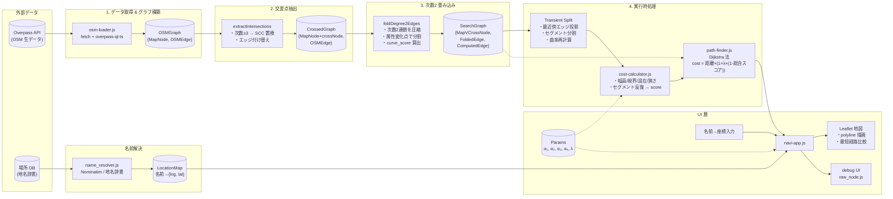

# データフロー図

## データ変換の対応表

| 段階 | 入力 | 処理 | 出力 |
|------|------|------|------|
| 1 | Overpass API (JSON) | `osm-loader.js` (overpass-ql-ts) | `OSMGraph { MapNode, OSMEdge }` |
| 2 | `OSMGraph` | `extractIntersections` | `CrossedGraph { MapNode+crossNode, OSMEdge }` |
| 3 | `CrossedGraph` | `foldDegree2Edges` | `SearchGraph { MapVCrossNode, FoldedEdge, ComputedEdge }` |
| 4 | `SearchGraph` | Transient Split | セッション用グラフ (分割エッジ) |
| 5 | セッション用グラフ | `cost-calculator.js` | score 付きエッジ |
| 6 | score 付きエッジ | `path-finder.js` (Dijkstra) | 経路 (NodeId 列) |
| 7 | NodeId 列 | `navi-app.js` | Leaflet polyline |

## ファイル対応

| ファイル | 責務 |
|----------|------|
| `osm-loader.js` | Overpass API 呼び出し → OSMGraph |
| `fold_degree2.js` (統合予定) | 次数2 畳み込み |
| `cross_transform.js` → `search_graph.js` | 交差点抽出 |
| `cost-calculator.js` | スコアリング |
| `path-finder.js` | Dijkstra 実行 |
| `name_resolver.js` | 名前→座標 |
| `navi-app.js` | Svelte UI 統合 |
| `raw_node.js` | デバッグ用生ノード表示 |
